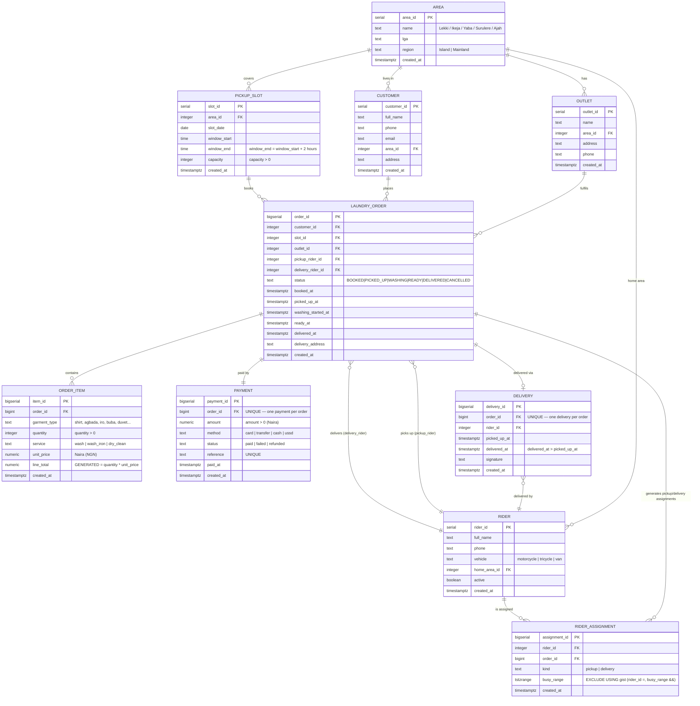

# FreshFold Laundry — ER Diagram (Mermaid)

Portfolio 1 · MIT 8103 Advanced Database Systems · Olla Babafemi · 2026/A/MIT/0111

This ER diagram models the FreshFold Laundry case study: a customer books a pickup
slot in an area (LGA), a rider collects the clothes, an outlet washes and irons
them, the customer pays, and a rider delivers the cleaned clothes back. The rider
can never be assigned two overlapping pickups OR deliveries — that rule is enforced
by the `rider_assignment` helper entity plus an EXCLUDE constraint on a `tstzrange`.

## Entity-Relationship Diagram (Mermaid `erDiagram`)



## How the rider non-overlap rule is enforced

`rider_assignment` is a helper entity (the 9 core entities are the ones the CA
asks for; this is a supporting table for the exclusion constraint). Every time
an order is given a `pickup_rider_id`, a trigger writes a `pickup` row whose
`busy_range` is the slot's 2-hour window. Every time a delivery is recorded, a
trigger writes a `delivery` row whose `busy_range` is `[picked_up_at, delivered_at]`.
The single constraint

```sql
EXCLUDE USING gist (rider_id WITH =, busy_range WITH &&)
```

then forbids any two rows for the same rider whose `busy_range`s overlap —
pickup vs. pickup, delivery vs. delivery, or pickup vs. delivery. `btree_gist`
is what lets a scalar column (`rider_id`) be combined with a range column
(`busy_range`) inside one `EXCLUDE USING gist`.

## Cardinalities at a glance

| Relationship | Cardinality |
| --- | --- |
| area → outlet | 1 : N (an area hosts many outlets) |
| area → customer | 1 : N (a customer lives in one area) |
| area → pickup_slot | 1 : N (a slot belongs to one area) |
| area → rider | 1 : N (a rider's home area) |
| customer → laundry_order | 1 : N |
| pickup_slot → laundry_order | 1 : N (many orders per slot, up to capacity) |
| outlet → laundry_order | 1 : N |
| rider → laundry_order (pickup_rider) | 1 : N |
| rider → laundry_order (delivery_rider) | 1 : N |
| laundry_order → order_item | 1 : N |
| laundry_order → payment | 1 : 1 (UNIQUE on order_id) |
| laundry_order → delivery | 1 : 1 (UNIQUE on order_id) |
| rider → rider_assignment | 1 : N |
| laundry_order → rider_assignment | 1 : N (one pickup + one delivery) |
